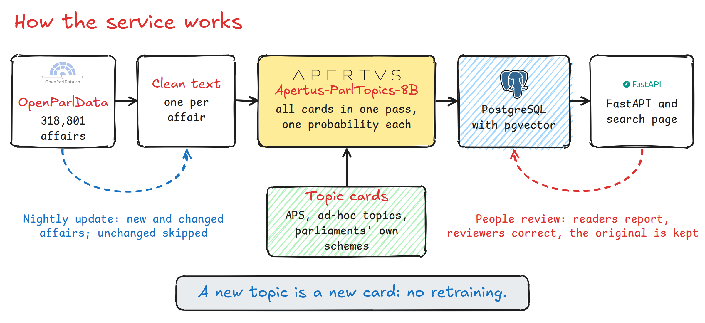
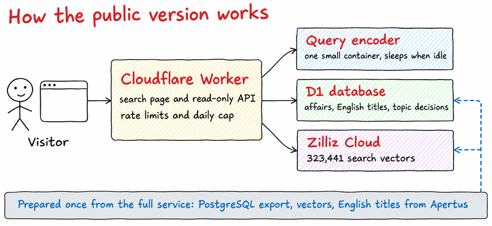

# Parlamentsthemen: topic classification for Swiss parliamentary affairs with Apertus

OpenParlData.ch collects more than 300,000 affairs from Swiss federal, cantonal and municipal parliaments in four languages. They are searchable mainly by full text. The few topic labels that exist follow different schemes. Parlamentsthemen is an open classification service based on Apertus. It assigns the two-level scheme of Année Politique Suisse (APS), parliaments' own schemes and ad-hoc topics without retraining. It serves a use case of Digital Public Services Switzerland: finding digitalisation affairs across the whole dataset.

**Try it:** https://parlamentsthemen.prakasharyan.dev is a public read-only version with all 323,441 affairs from 88 parliaments. It accepts searches in English and the four national languages and shows English titles ([deploy/cloudflare](deploy/cloudflare/README.md)).

| Resource | URL |
|---|---|
| Apertus v1.5 8B (base) | [huggingface.co/swiss-ai/Apertus-v1.5-8B](https://huggingface.co/swiss-ai/Apertus-v1.5-8B) |
| Apertus v1.5 70B (drafting topic cards) | [huggingface.co/swiss-ai/Apertus-v1.5-70B](https://huggingface.co/swiss-ai/Apertus-v1.5-70B) |
| Apertus-ParlTopics-8B (our trained decision model) | [huggingface.co/merabro/Apertus-ParlTopics-8B](https://huggingface.co/merabro/Apertus-ParlTopics-8B) |
| Demo video (2 minutes) and slides | [demo_captioned.mp4](https://prakash-aryan.github.io/parlamentsthemen/media/demo_captioned.mp4), [slides](https://prakash-aryan.github.io/parlamentsthemen/) |
| Technical report | [technical_report.md](technical_report.md), [Invincibles_Report.pdf](Invincibles_Report.pdf) |

## How it works



Every topic of every scheme is written as a short **topic card**. Apertus-ParlTopics-8B, Apertus 1.5 8B trained as a **decision model**, reads an affair once and returns one score per card, calibrated where labelled affairs exist. A new topic is a new card plus a validated threshold, not a retraining run.

The stored decisions cover all 323,441 affairs for the seven ad-hoc topics and 22 APS topics, the 2,751 Curia Vista affairs for the 28 federal topics and 105 St. Gallen affairs for the canton's nine categories. Affairs without stored results get live decisions from Apertus-ParlTopics-8B when its server is configured, otherwise from untrained Apertus 1.5 8B, which also writes the "Warum" explanations. Readers can report a wrong topic and reviewers can correct it; the model's original decision is kept. Results live in PostgreSQL with pgvector behind a FastAPI service and a search page in five interface languages.



The public version runs on Cloudflare without a GPU: it serves the stored decisions only, so explanations, reports and review are switched off there.

## The structure

| Path | What it is |
| --- | --- |
| `src/parltopics` | Data preparation, topic cards, decision model client, evaluation, database and API |
| `web/` | The search page (Next.js), exported as static files |
| `cards/` | Topic cards (YAML) and their names in five languages |
| `models/` | Calibration and thresholds per topic |
| `scripts/gpu/`, `third_party/kev/` | Training and serving the decision model; the patch that adapts Kev to Apertus 1.5 |
| `deploy/cloudflare/` | The public read-only version |
| `hop/` | The nightly update as an Apache Hop workflow |
| `technical_report.md`, `figures/` | Architecture, evaluation and limitations |

## Environment

Copy `.env.example` to `.env`. `POSTGRES_PASSWORD` is the only required setting; the others switch on optional features.

| Variable | Effect |
|---|---|
| `LLM_NAME`, `LLM_BASE_URL`, `LLM_API_KEY` | An OpenAI-compatible Apertus endpoint with token log-probabilities, for the "Warum" explanations and for live decisions without a trained-model server |
| `PARLTOPICS_DECISION_URL` | An Apertus-ParlTopics-8B server (`scripts/gpu/serve_model.sh`), so that live decisions come from the trained model |
| `PARLTOPICS_REVIEW_TOKEN` | Access code for review mode ("Prüfmodus" in the footer) |
| `ELEVENLABS_API_KEY`, `ELEVENLABS_VOICE_ID`, `PARLTOPICS_SPEECH_DAILY_CHARS` | Read-aloud and voice search through ElevenLabs, capped per day (default 20,000 characters). The text leaves the deployment, so leave the key unset for a fully on-premise service; the page then uses the browser's own speech |

## Run it

Docker with Compose, about 5 GB of disk and 2 GB of RAM; no GPU. The demo bundle in `data/demo/` holds 5,000 real affairs from 88 parliaments with their texts, search embeddings and 123,385 stored topic decisions, so a fresh clone runs without the full corpus.

```bash
cp .env.example .env    # set POSTGRES_PASSWORD
docker compose up -d db
docker compose build app
docker compose run --rm app python -m parltopics.demo load --dir data/demo
docker compose up -d app
curl -s localhost:8765/health    # wait for "encoder": "ready", then open http://localhost:8765
```

On a fresh copy the build took 5.4 minutes and the bundle loaded in 14 seconds. The first start downloads the query encoder (harrier-oss-v1-0.6b, 1.1 GB), which took 6.7 minutes on our connection; later starts are ready in about 20 seconds. Set `APP_PORT` or `DB_PORT` if 8765 or 5433 is taken.

Without a model endpoint, everything that reads stored results works. Live classification (`POST /classify`) and the explanations return HTTP 503 naming the missing setting. A trained-model server on the Docker host is reachable from the container at `http://host.docker.internal:8350` if it listens on the Docker bridge, for example through `ssh -N -L 172.17.0.1:8350:localhost:8350 <gpu-server>`.

For the full corpus, prepare `data/` and `runs/` as in "Reproduce the results", then:

```bash
for step in init affairs embeddings index topics export; do
  docker compose run --rm app python -m parltopics.db $step
done
docker compose run --rm app python -m parltopics.db scores --dir <score folders> --run-id parltopics8b_corpus
```

Without Docker: `uv sync --extra db --extra embed`, `cd web && npm ci && npm run build`, then `uv run uvicorn parltopics.api:app --port 8765`.

### API

| Endpoint | Returns |
|---|---|
| `GET /search?q=&topic=&level=&body=&year_from=&year_to=` | Affairs ranked by meaning in any language, with filters |
| `GET /overview` (same filters) | Counts by parliament and outcome; for a text query, over the 100 best matches |
| `GET /topics` | All topic cards with names in five languages and their scope |
| `GET /affairs/{id}/detail`, `/similar`, `/topics`, `/topics/live` | One affair: details and links, similar affairs, stored and live topics |
| `GET /topics/{topic}/affairs?decision=&min_probability=&order=&since=&until=` | Stored affairs for a topic. The weekly digitalisation shortlist for DVS: `/topics/adhoc_digitalisation/affairs?min_probability=0.02735447&order=newest&since=2026-10-12` (recall 0.97 at precision 0.18 on the test affairs, `models/monitoring_adhoc_digitalisation_parltopics8b.json`) |
| `POST /classify` | A live decision with probability, passage and reason for any affair in the OpenParlData API |
| `POST /flags`, `GET /flags`, `/review/*` | Topic reports and reviewer corrections (`X-Review-Token` header) |
| `GET /speech`, `POST /speech`, `POST /speech/transcribe` | Read-aloud (MP3) and voice search |

## Nightly update

`uv run python -m parltopics.nightly --since YYYY-MM-DD` fetches affairs created or changed since the date, skips those whose text hash is unchanged, scores the rest for every active topic card and writes the rows to PostgreSQL. `hop/nightly.hwf` runs it as an Apache Hop workflow after OpenParlData's nightly export, with the Hop image in `hop/Dockerfile`. It has run by hand, with the trained model and with the `LLM_*` endpoint; scheduled runs are not yet validated.

## Reproduce the results

1. **Data.** Put the OpenParlData export (`https://files.openparldata.ch/exports/`) in `data/raw/export/` and the label folder (`https://files.openparldata.ch/hackapertus/`) in `data/raw/labels/`, then run `uv run python -m parltopics.prepare --raw data/raw --out data` and `uv run python -m parltopics.labels --raw data/raw --data data`.
2. **Topic cards.** `uv run python -m parltopics.cards` drafts a card with Apertus 70B; the cards used here are in `cards/`.
3. **Training.** `scripts/gpu/kev_setup.sh` installs Kev at commit 1f04cfa with `third_party/kev/apertus.patch`; `parltopics.build_train` and `parltopics.build_extra` write the training data; `scripts/gpu/launch_train.sh` trains (four RTX A6000, data folder in `DATA_ROOT`).
4. **Corpus labelling.** `scripts/gpu/serve_model.sh` serves the trained model, `parltopics.systemone_multi` scores affairs against a set of cards, `parltopics.db scores` loads the results and `parltopics.embed` computes the search embeddings.
5. **Results.** The technical report describes the evaluation sets, baselines and metrics; `parltopics.evaluate` holds the calibration and metric functions.

## Credits

- AI tools were used for documentation and debugging.
- The repository started from the Hack Apertus template (github.com/HackApertus/liebefeld).
- The decision-model training and serving code is adapted from Kev (github.com/jaredpalmer/kev, Apache-2.0), an open implementation of the idea behind TypeSafe's System One models.
- Data: OpenParlData.ch (open government data); Curia Vista data from the Parliamentary Services of the Federal Assembly.
- Models: Apertus 1.5 by the Swiss AI Initiative (Apache-2.0, gated download with an acceptable use policy); harrier-oss-v1-0.6b (MIT).
- Compute: CSCS inference via the Keera gateway; our own GPU server (four RTX A6000).
- Calculations were performed on UBELIX (https://www.id.unibe.ch/hpc), the HPC cluster at the University of Bern, for scoring new and changed affairs with Apertus-ParlTopics-8B and for translating titles and topic names with Apertus 1.5 8B.

## License

Code under Apache-2.0 (see `LICENSE`). OpenParlData.ch data under CC BY 4.0 (source: OpenParlData.ch). Apertus 1.5 under Apache-2.0 with an acceptable use policy.
