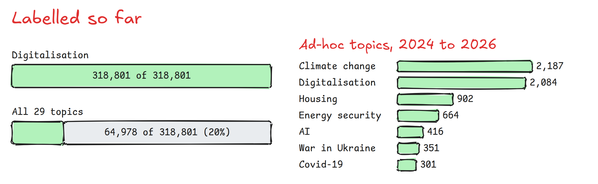
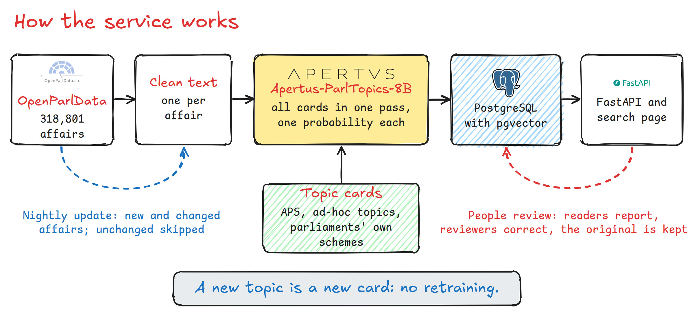
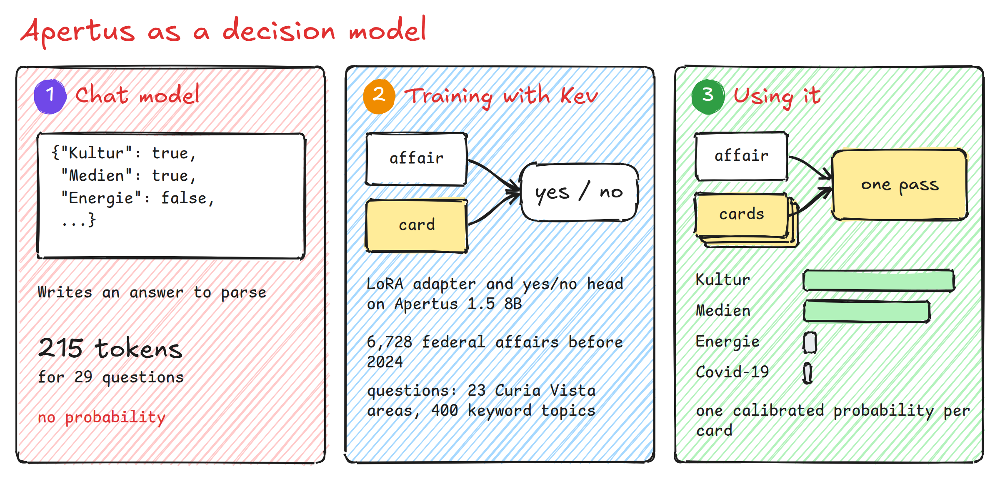
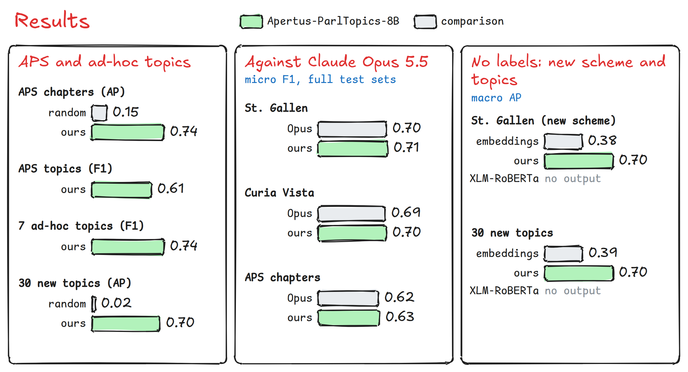

# Technical report: Parlamentsthemen

Topic classification for Swiss parliamentary affairs with Apertus.

- **Code:** https://github.com/prakash-aryan/parlamentsthemen
- **Model:** https://huggingface.co/merabro/Apertus-ParlTopics-8B
- **Team:** Invincibles (Kaushik Raghupathruni, Vilas Harapanahalli, Vaibhav Motwani, Prakash Aryan)
- **Challenge:** OpenParlData, Topic classification for Swiss parliaments with Apertus (https://hackapertus.notion.site/openparldata)
- **Event:** Liebefeld, 18 and 19 October 2026
- **Demo:** to be added

## 1. Summary

OpenParlData.ch publishes 326,396 parliamentary affairs. After the exclusion of 4,380 affairs of the Liechtenstein parliament and of records removed during data preparation, our snapshot comprises 318,801 affairs from 88 Swiss parliaments. These affairs are accessible mainly through full-text search. Only 22% of them carry a subject area from Curia Vista or from one of four local schemes, each parliament uses its own scheme, and no affairs labelled with the scheme of Année Politique Suisse (APS) were available.

We trained Apertus 1.5 8B as a decision model, Apertus-ParlTopics-8B. Given the text of an affair and a set of topic cards, which are short written definitions of topics, the model returns one calibrated probability per card in a single forward pass. A classification scheme is therefore a set of cards, and a new topic requires a new card rather than retraining, although its decision threshold still requires validation. Each decision is interpretable: the probability and the threshold are stored with every decision, the cards are written in plain language that anyone can read and edit, and the search page shows the supporting passage and a short reason for every suggested topic.

The model has assigned the 22 APS chapters and seven ad-hoc topics to all 49,978 affairs from 2024 to 2026 and the topic digitalisation to all 318,801 affairs. The remaining 28 topics are being added to the older affairs in reverse chronological order. At the time of writing, 64,978 affairs carry all 29 topics, and the remaining 253,823 affairs require approximately 90 GPU-hours.

On affairs from 2024 to 2026, Apertus-ParlTopics-8B achieves a macro average precision (AP) of 0.74 on the 22 APS chapters without any APS training labels, an F1 score of 0.61 on the 165 APS topics and of 0.74 on the seven ad-hoc topics against blind reference labels from Claude Opus 5.5, and a macro AP of 0.70 on 30 new topics defined by a single keyword. On the complete St. Gallen, Curia Vista and APS chapter test sets, it matches Claude Opus 5.5 (micro F1 0.71, 0.70 and 0.63 against 0.70, 0.69 and 0.62). In combination with an embedding classifier, it is the best of the compared systems on digitalisation (AP 0.49) and on Curia Vista (macro AP 0.76). The service works across the national languages: on the same affairs in German, French and Italian, the quality is equal (macro AP 0.71, 0.70 and 0.70), a query in one language finds affairs in the others, and the interface, search and read-aloud are also available in Romansh.

## 2. Architecture

| Component | Function | Deployment |
|---|---|---|
| Ingestion | One cleaned text per affair from the OpenParlData export (official texts or attached documents) | CPU |
| Topic cards | Written definitions: 22 APS chapters, 165 APS topics, 7 ad-hoc topics and parliaments' own schemes | Files |
| Decision model | Apertus-ParlTopics-8B evaluates all cards of an affair in one pass | One GPU |
| Explanations | Passage and reason for a suggested topic, generated by Apertus 1.5 8B | Hosted endpoint |
| Embeddings | harrier-oss-v1-0.6b vectors for search by meaning | PostgreSQL |
| Storage | Decisions with probability, threshold, model and card version; reports and corrections | PostgreSQL with pgvector |
| Access | FastAPI and a Next.js search page with review mode, read-aloud and spoken queries | One container |

The intended deployment is on premises: `docker compose` starts PostgreSQL and the web and API container, and the decision model runs on a separate GPU server.

**Operation.** A nightly job evaluates new and changed affairs and stores each decision with the model revision and card version; a change of model or card triggers re-evaluation. The remaining work comprises the scheduling of the nightly Apache Hop workflow, the completion of the older affairs, a review of the cards with Digital Public Services Switzerland (DVS), recalibration from reviewer corrections behind an evaluation gate, and a pilot of the weekly digitalisation shortlist with DVS.

## 3. Use of Apertus

Apertus 1.5 8B (`swiss-ai/Apertus-v1.5-8B`) is the base of the decision model and generates the explanations shown on the search page. Apertus 1.5 70B (`swiss-ai/Apertus-v1.5-70B`) drafted the topic cards. Training, evaluation and corpus labelling were carried out on our GPU server with four RTX A6000 GPUs. Apertus 70B and the explanations were accessed through the Keera gateway, which provides access to inference at CSCS.

**Training.** The training builds on Kev, an open implementation (Apache-2.0) of decision models, which we adapted to the text part of Apertus 1.5 8B (`third_party/kev/apertus.patch` on upstream commit 1f04cfa). The model consists of a LoRA adapter of rank 16 and a yes/no head; training used bf16, a learning rate of 5e-5, one epoch, label smoothing of 0.1 and inputs truncated to 1,024 tokens. The training data comprise 6,728 records from 6,553 federal affairs dated before 2024; 25 further records exceeded the context length. The questions cover 23 of the 28 Curia Vista subject areas and the 400 most frequent Curia Vista descriptors. The five remaining subject areas, the topic digitalisation, all cantonal and municipal schemes and the APS scheme were excluded from training. The configuration, the training metrics, the adapter (159 MB) and the head (8 MB) are published at https://huggingface.co/merabro/Apertus-ParlTopics-8B.

**Inference.** Each card is presented as the question whether the affair concerns the defined topic, and all questions for an affair are answered in a single request. Scores are calibrated with Platt scaling, and thresholds are fitted where labelled earlier affairs exist: for digitalisation, the Curia Vista areas and 16 APS chapters through the mapping from Curia Vista. Six APS chapters and six ad-hoc topics use a shared default threshold and are marked as uncalibrated. APS topics were evaluated in two steps, first the chapters and then the topics of the three most likely chapters; the stored corpus contains the 22 chapters.

## 4. Data and evaluation

All data are open government data from OpenParlData (export and label folder, snapshot of 18 October 2026): the Curia Vista subject areas and descriptors, the schemes of St. Gallen, Thurgau and the city of Zug, the PolitMonitor tag "Digitalisierung" (3,433 tags, of which 3,431 are in our corpus), the list of 30 affairs published by DVS and the APS scheme. DVS currently relies on the manually assigned PolitMonitor tags.

**Protocol.** Affairs dated before 2024 were used for training, calibration and thresholds, and affairs from 2024 to 2026 for testing. Because the test period also served to select between models, a later period should confirm the results. The supervised baselines follow earlier work: a legal XLM-RoBERTa after the 2023 study of POLITmonitor and BFH, and a logistic-regression classifier on embeddings after Demokratis.

**APS on two levels.** No APS labels were used in training. Against the mapping from Curia Vista, the 22 chapters reach a macro AP of 0.74 on 1,000 federal affairs, where random ranking would give 0.15, and 0.92 to 0.94 for the chapters with the clearest mapping. Against blind labels from Claude Opus 5.5, the stored chapter decisions reach an F1 score of 0.66 on 500 cantonal and 0.57 on 200 municipal affairs. On 500 federal affairs, the 165 topics reach an F1 score of 0.61 against the same reference; 96.4% of the affairs share at least one topic with it, and the shortlist of three chapters retains 88.7% of its topics.

**Ad-hoc topics without retraining.** The seven ad-hoc topics (digitalisation, climate change, housing shortage and rents, energy supply security, artificial intelligence, Covid-19 and the war in Ukraine) are assigned to 2,084, 2,187, 902, 664, 416, 301 and 351 of the 49,978 affairs from 2024 to 2026. Against blind labels from Claude Opus 5.5 on 400 affairs, they reach an F1 score of 0.74 (precision 0.81, recall 0.69), with 0.84 for digitalisation and 0.67 for climate change. For the DVS use case, the model finds 20 of the 30 DVS-listed affairs at the default threshold and 29 of 30 at a monitoring threshold fitted on earlier affairs for a recall of 90%; on the test affairs, this threshold yields a recall of 0.97 at a precision of 0.18, or about 37 affairs per week. Thirty new topics, each defined only by a descriptor keyword, reach a macro AP of 0.70 on a historical holdout, where random ranking would give 0.02.

**Four national languages.** The same 871 federal affairs in German, French and Italian reach a Curia Vista macro AP of 0.71, 0.70 and 0.70, so the quality does not depend on the language of the text. Search works across languages, so that a French query also finds German affairs. The interface is available in German, French, Italian, Romansh and English, and in a qualitative check, four of five Romansh queries found relevant affairs written in other languages. The corpus contains no affairs in Romansh, so no Romansh classification test was possible.

**Comparison with earlier approaches.**

| System | Labelled training data | Digitalisation AP | Curia Vista macro AP | New scheme (St. Gallen), no labels | 30 new topics, no labels |
|---|---|---|---|---|---|
| Apertus 1.5 8B, untrained | none | 0.43 | 0.51 | 0.57 | |
| Legal XLM-RoBERTa | 20,000 affairs, these 28 areas, three epochs | 0.42 | 0.73 | no output | no output |
| Embedding classifier | 20,000 affairs, these 28 areas | 0.47 | 0.74 | 0.38 | 0.39 |
| **Apertus-ParlTopics-8B** | **6,728 affairs, one epoch, one model for all schemes** | **0.46** | **0.71** | **0.70** | **0.70** |
| **Apertus-ParlTopics-8B with embedding classifier** | **as above** | **0.49** | **0.76** | | |

On digitalisation, Apertus-ParlTopics-8B outperforms the legal XLM-RoBERTa (0.46 against 0.42) and performs on a par with the embedding classifier (0.47). On Curia Vista, the supervised classifiers were trained on three times as many labelled affairs, specifically for the 28 tested areas, and exceed Apertus-ParlTopics-8B by 0.02 to 0.03. The combination of both reaches 0.49 on digitalisation and 0.76 on Curia Vista, the highest values among the compared systems. On a new scheme and on new topics without labels, Apertus-ParlTopics-8B reaches a macro AP of 0.70, whereas the same embeddings matched to the card text reach 0.38 and 0.39 and the legal XLM-RoBERTa produces no output; the embedding classifier requires about 400 labelled St. Gallen affairs to reach 0.70.

**Comparison with a frontier model.** Claude Opus 5.5 classified every test affair of three complete schemes without access to the reference labels or to our model's answers. Apertus-ParlTopics-8B matches the frontier model on all three schemes and has the higher point estimate in each case; the 95% bootstrap intervals of the differences include zero. Claude Opus 5.5 is a closed model of undisclosed size served through an external API, whereas Apertus-ParlTopics-8B is an open model with 8 billion parameters that runs on a single GPU.

| Test set | Claude Opus 5.5 | Apertus-ParlTopics-8B |
|---|---|---|
| St. Gallen, 868 cantonal affairs, micro F1 | 0.704 | **0.708** |
| Curia Vista, 1,000 federal affairs, micro F1 | 0.689 | **0.698** |
| APS chapters, 1,000 federal affairs, micro F1 | 0.621 | **0.633** |

**Further results.** The recall for digitalisation is equal for federal and cantonal affairs (0.77) and reaches 0.90 or more in every language group at the monitoring threshold. Grouped by the authors' parliamentary groups, the F1 scores on 1,000 federal affairs lie between 0.66 and 0.74 without aggregate over- or under-assignment.

## 5. Limitations

- No APS-labelled affairs were available, so the APS results rest on a mapping from Curia Vista and on an automated reference; the APS cards have not all been reviewed.
- The explanations are generated by untrained Apertus 1.5 8B, and reviewer corrections do not yet feed into recalibration or retraining.
- About 57,600 affairs consist of a title only; at the default threshold the model finds 24% of the short tagged affairs, and at the monitoring threshold 90% or more.
- No Romansh test set exists, and the party analysis covers federal affairs only.

## 6. Reproducibility

- **Hardware:** four RTX A6000 GPUs (48 GB) for training, evaluation and corpus labelling; the search page and the API run on a laptop.
- **Runtime:** 4.9 affairs per second for one topic and 0.8 for all 29 topics on one GPU; one topic over all 318,801 affairs requires about 18 GPU-hours.
- **Setup:** copy `.env.example` to `.env`, set `LLM_NAME`, `LLM_BASE_URL`, `LLM_API_KEY` and `DATABASE_URL`, and start the services with `docker compose` as described in the README, which also specifies the layout of the raw data.
- **Code and results:** the GPU scripts are in `scripts/gpu/` and `scripts/`, and the evaluation scripts in `scripts/evaluation/` recompute the figures in this report. The training configuration, the metrics, the adapter and the head are published at https://huggingface.co/merabro/Apertus-ParlTopics-8B.
- **Repository:** https://github.com/prakash-aryan/parlamentsthemen

## License

Text under Creative Commons Attribution 4.0 (CC BY 4.0) and code under Apache-2.0. Apertus 1.5 is released under Apache-2.0 with an acceptable use policy.

## References

1. OpenParlData: https://openparldata.ch; label folder https://files.openparldata.ch/hackapertus/
2. Project Apertus (ETH Zurich, EPFL, CSCS), "From Open Text Models to Open Multimodal Reasoners: Apertus v1.5 Technical Report", October 2026: https://huggingface.co/papers/2610.15542; model card: https://huggingface.co/swiss-ai/Apertus-v1.5-8B
3. TypeSafe, "Introducing System One models and Jev": https://typesafe.ai/blog/introducing-system-one-models-and-jev
4. Kev: https://github.com/jaredpalmer/kev
5. Demokratis classification: https://github.com/Demokratis-ch/demokratis-ml
6. Année Politique Suisse topics: https://anneepolitique.swiss/de/themen/
7. OpenParlData wiki, prior work on classification: https://gitlab.com/groups/opendata.ch/openparldatach/-/wikis/Home/Future-Topics/Classification
